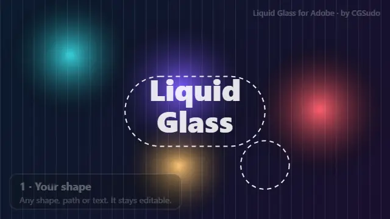
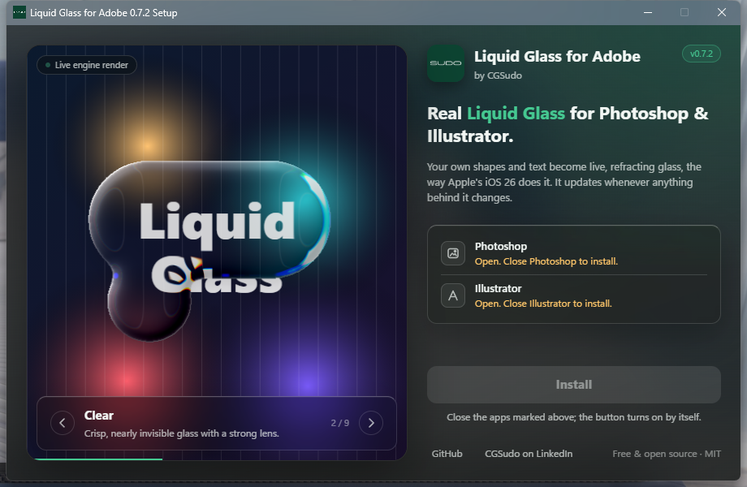

# Liquid Glass for Adobe: Apple's Liquid Glass effect for Photoshop and Illustrator (free plugin)

**Stop faking glass. Make it real, keep it live.**

**Liquid Glass for Adobe** (by CGSudo) is a free, open-source plugin that recreates Apple's **Liquid Glass** material from **iOS 26** and **macOS Tahoe** inside **Adobe Photoshop** and **Adobe Illustrator**. Your own shapes and text become real, refracting glass in one click. Nothing gets merged or flattened, and the glass re-renders whenever anything behind it changes.

> One click. Real refraction. Zero flattened layers.



**[Try the live demo](https://cgsudo.github.io/liquid-glass-for-adobe/)**: the real glass engine running in your browser. Drag the glass around and switch looks.

## Download
Get everything from the **[latest release](../../releases/latest)**:

| You want | Download | Works on |
|---|---|---|
| **Everything, one click** (Photoshop + Illustrator) | `LiquidGlass-for-Adobe-<version>-Setup.exe` | Windows 10 / 11 |
| **Everything for Windows and Mac** in one zip | `LiquidGlass-for-Adobe-<version>-AIO-Windows-Mac.zip` | Windows + macOS |
| **Photoshop only** | `LiquidGlass-for-Adobe-Photoshop-<version>.ccx` | Windows + macOS |
| **Illustrator only** | `LiquidGlass-for-Adobe-Illustrator-<version>-Windows.zip` | Windows |
| **Source code, Photoshop plugin** | `LiquidGlass-for-Adobe-Photoshop-<version>-source.zip` | |
| **Source code, Illustrator plug-in** | `LiquidGlass-for-Adobe-Illustrator-<version>-source.zip` | |



> **Honest status:**
> - Tested on Windows with Photoshop 2026 and Illustrator 2026.
> - The Photoshop plugin has no platform-specific code but hasn't been tested on a Mac yet. If you try it, please [open an issue](../../issues).
> - **Illustrator is Windows only for now.** A Mac build is planned.
> - The effect images here are renders from the plugin's own engine on test shapes.
> - Setup isn't code-signed yet, so Windows SmartScreen may say "Windows protected your PC": click **More info › Run anyway**.

## Install
- **Windows (both apps):** close Photoshop and Illustrator, run `LiquidGlass-for-Adobe-<version>-Setup.exe` and click **Install**. Windows asks once for permission (Illustrator's Plug-ins folder needs it). Setup installs into every Photoshop and Illustrator it finds. IT admins: `Setup.exe --silent`.
- **Mac or Photoshop only:** double-click `LiquidGlass-for-Adobe-Photoshop-<version>.ccx`. The Creative Cloud desktop app installs it.
- **Illustrator only, by hand:** unzip and copy `LiquidGlass.aip` into `C:\Program Files\Adobe\Adobe Illustrator <version>\Plug-ins\Liquid Glass\`.

Then: **Photoshop › Plugins › Liquid Glass for Adobe**, or in Illustrator select a shape and choose **Effect › Stylize › Liquid Glass…**.

Needs Photoshop 2023 (v24.2) or newer, or Illustrator 2026, and the Creative Cloud desktop app for Photoshop plugins.

## Why designers switch
- **"I re-did that glass five times today."** The glass reads what's behind it on every change. Move the photo, edit the text, nudge the shape: the glass catches up by itself.
- **"Glassmorphism always looks flat."** Real glass *bends* light. The rim refracts what's behind it, splits it into a subtle rainbow, and catches the light like an embossed edge, the way Apple's Liquid Glass does.
- **"Merging layers wrecks my file."** Your shapes and text stay fully editable. Undo, re-edit, and hand the file off without fear.
- **"I just want the frosted look, fast."** Pick a look (Frosted, Glassmorphism, Ice, Smoked, Crystal, Bubble…), then fine-tune it with four sliders that are always on screen.

## Features
- **One click, non-destructive:** works on your shape and text layers (Photoshop) or any shape, group or text as a live effect (Illustrator).
- **Live updates:** move, resize or reshape the glass, edit the text, or change anything behind it, and the glass re-renders.
- **9 looks:** Liquid Glass, Clear, Frosted, Glassmorphism, Ice, Smoked, Crystal, Bubble and Film frost. **Save your own looks** and use them in every document.
- **Quick controls:** Frost, Lens, Edge width and Shine stay on screen, with fine control at low values.
- **Exact outlines:** rectangles, ellipses, Pen paths, combined shapes, and the letter outlines of **text**. In Illustrator, strokes and variable-width profiles become glass too.
- **Liquid merge:** several shapes melt together, growing liquid bridges with rounded inner corners.
- **Real optics:** lens refraction, light dispersion (rainbow edge), frost, vividness, tint, two rim lights with a direction dial, and a bevel/emboss.
- **Advanced controls:** emboss, rim line, glass type (index of refraction from air to diamond) and sheen.
- **Inner glow** with blend modes, **stroke** in a solid colour or gradient, **drop shadow**, **dim background** and **film grain**.
- **Explained in plain words:** every setting has a small icon and a hover explanation; double-click a setting's name to reset it.
- **Fast:** the renderer is written in **Rust** (WebAssembly in Photoshop, native in Illustrator).

## How to use
**Photoshop**
1. Draw shapes with a Shape tool or the Pen tool in Shape mode, or type some text.
2. Select those layers and click **Make Glass**.
3. Pick a look, fine-tune with the quick sliders, and explore the tabs:

| Tab | Controls |
|---|---|
| **Glass** | edge softness, dispersion, merge; **Advanced:** emboss, rim line, glass type, sheen |
| **Light** | light direction dial, brightness, vividness, tint |
| **Shadow** | drop shadow; dim background |
| **Finish** | inner glow, stroke, film grain, edge effects (Layer Styles) |

- **Adding more:** select the glass plus the new layers and click **Make Glass**, or drag them into the glass group.
- **Moving:** move your shapes or the whole group. Leave the `◆ glass render (automatic)` folder alone; the plugin manages it.
- **Pixel layers** can't become glass. Use a shape or text layer.

**Illustrator**
1. Select a shape, group or text and choose **Effect › Stylize › Liquid Glass…**.
2. Pick a look and adjust it in the settings window; **Preview** shows changes on the artboard.
3. To change it later, double-click **Liquid Glass** in the Appearance panel, or use **Object › Edit Liquid Glass…**.
4. **Object › Refresh All Liquid Glass** re-reads the background of every glass. The glass also refreshes by itself when the art behind it changes.

Liquid Glass refuses things that can't work and tells you why: pixel images, groups that contain an image, and a second Liquid Glass on the same object.

## FAQ
**How do I make Apple's Liquid Glass effect in Photoshop?**
Install Liquid Glass for Adobe, select a shape or text layer and click **Make Glass**. Without a plugin you would blur a merged copy of the background, clip it to a shape and paint highlights by hand: a static fake that breaks the moment anything moves.

**How do I make the iOS 26 glass effect in Illustrator?**
Select a shape, group or text and choose **Effect › Stylize › Liquid Glass…**. It is a live effect in the Appearance panel, so the shape stays editable.

**Is it free?** Yes. It is open source under the MIT licence.

**Is this glassmorphism?** Glassmorphism is frosted blur with a light border. Liquid Glass adds real refraction: the edge bends and magnifies what's behind it, with a rainbow fringe and rim light. The plugin does both (try the *Glassmorphism* and *Frosted* looks).

**Does it work on Mac?** The Photoshop plugin runs on macOS (Intel and Apple Silicon) but hasn't been tested on a Mac yet. Illustrator is Windows only for now.

**Does it flatten or change my layers?** No. Your shapes and text stay editable, and reading the background never changes the document.

**Is it made by Adobe or Apple?** No. It is an independent project by CGSudo.

## Roadmap
- [x] **Photoshop** (Windows and macOS): available
- [x] **Illustrator** (Windows): available
- [ ] **Illustrator for Mac**: planned
- [ ] **After Effects** and **Premiere Pro**: planned, not started
- [ ] GPU rendering, linear-light blending, light/dark adaptive tint

## How it works
```
core/        Rust renderer (glass_core): backdrop + shape masks → glass layer + shadow layer
photoshop/   UXP plugin: panel, live updates, vector and text outline reader, WebAssembly bridge;
             looks.js (defaults, looks and icons) is shared with Illustrator and Setup
illustrator/ native Live Effect (C++, Illustrator SDK) with a WebView2 settings window
setup/       the Windows Setup.exe: glass window, live tour of the looks, one-click install of both plugins
preview/     renders the preview images from test shapes
docs/        project website (GitHub Pages) and the full project history
```
1. Each shape becomes a signed distance field. Several shapes join through a smooth union, which makes the liquid merge.
2. A squircle bevel gives surface normals. Those drive Snell refraction with per-channel dispersion, then bevel shading, rim lights, inner glow and stroke.
3. The refracted backdrop is frosted, colour-graded and tinted. The shadow and dim halo go on their own layer.
4. Photoshop reads the backdrop inside a history step that it rolls back; Illustrator rasterizes the art below the glass. Your document is never changed by a read.

Working on the code, or pointing an AI coding agent at it? Start with [AGENTS.md](AGENTS.md) and [docs/PROJECT_HISTORY.md](docs/PROJECT_HISTORY.md).

## Build from source
Needs [Rust](https://rustup.rs) and Node.js. Run `rustup target add wasm32-unknown-unknown` once.
```bash
npm install
```
```bash
npm test
```
**Photoshop:** after changing the engine, rebuild it and copy `target/wasm32-unknown-unknown/release/glass_core.wasm` into `photoshop/`:
```bash
cargo build -p glass_core --release --target wasm32-unknown-unknown
```
Package as `dist/LiquidGlass-for-Adobe.ccx` and install with `powershell -ExecutionPolicy Bypass -File install.ps1` (Windows) or `sh install.sh` (macOS). Add `-NoInstall` / `--no-install` to only build the package.

**Illustrator (Windows):** needs Visual Studio C++ Build Tools, the [Illustrator SDK](https://developer.adobe.com/console) and the Microsoft.Web.WebView2 NuGet package. See [illustrator/README.md](illustrator/README.md).

**Setup.exe and every release file:** `powershell -ExecutionPolicy Bypass -File release.ps1` builds both plugins, Setup.exe and all downloads into `dist/release`.

## Known limits
- RGB documents only in Photoshop; Illustrator works in RGB and warns in CMYK documents.
- Photoshop updates land when you release the mouse: Photoshop doesn't run plugins mid-drag.
- Each live update in Photoshop is a history step, so undoing an edit takes two steps.
- Brush strokes in Photoshop don't trigger an update: press **Refresh**.

## About
Made by **CGSudo**. [Connect on LinkedIn](https://www.linkedin.com/in/cgsudo). Website: [cgsudo.github.io/liquid-glass-for-adobe](https://cgsudo.github.io/liquid-glass-for-adobe/).

## License
[MIT](LICENSE) © CGSudo. Liquid Glass for Adobe is an independent project, not affiliated with or endorsed by Adobe or Apple. Adobe, Photoshop and Illustrator are trademarks of Adobe; "Liquid Glass" refers to Apple's design material.
